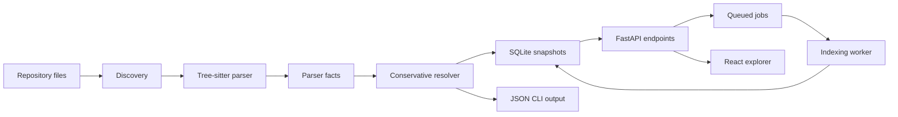

# Architecture

The current architecture keeps parser output independent from HTTP and storage. `backend.app.domain.model` defines the records shared by parsing and resolution. `backend.app.parsers.python` knows Tree-sitter details. `backend.app.resolution.python` converts extracted facts into resolved edges where the evidence is explicit enough.

SQLite snapshots now store files, nodes, edges, unresolved references and jobs. FastAPI serves completed snapshots through typed endpoints. Index requests enqueue jobs, and `backend.app.jobs.worker` claims and runs them outside the API request path.

The frontend calls those endpoints directly from the browser, renders bounded graph neighborhoods with vis-network, and fetches node details for the source evidence panel.
